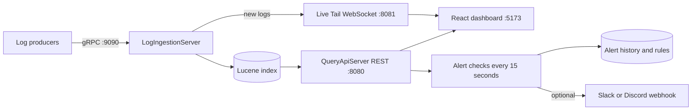

# LogStream — Distributed Log Analytics & Alerting Platform

LogStream is a Java and React prototype for collecting, indexing, searching, and monitoring application logs. It ingests logs from multiple services, indexes them with Apache Lucene, shows trends on a live dashboard, and raises alerts when error activity crosses a threshold. It was developed for the Axlero Solutions internship project **Observability & Big Data** (Project 2).

> **Project status:** This repository demonstrates the core workflow on a local development setup. The high-throughput and millisecond-latency goals in the project brief have not been benchmarked, and several brief features are not implemented yet. See [Current scope](#current-scope-and-project-brief) for details.

## The problem

Modern systems are made of many small services, and each one produces its own stream of logs. Searching large volumes of logs in a standard relational database does not scale well, because a keyword search can mean scanning every row. Teams need a tool that takes in logs from many services, indexes them for fast search, and shows problems as they happen. This is the idea behind stacks like ELK (Elasticsearch, Logstash, Kibana). LogStream builds a small version of that idea from scratch.

## What it does

- Accepts log entries over gRPC using Protocol Buffers.
- Indexes log service, level, message, and timestamp fields with Apache Lucene.
- Provides a REST API for search, aggregations, timeline data, and alerts.
- Displays log data in a React dashboard built with Vite.
- Pushes newly received logs to connected dashboard clients over WebSocket (Live Tail).
- Supports a built-in error-rate alert and user-defined threshold rules by service and level, with optional Slack or Discord webhooks.
- Keeps a history of past alerts, both built-in and rule-based.

## How it works



### A log, step by step

1. A service produces a log, for example `payment-service` logs `ERROR: Payment gateway timeout`.
2. The log is sent to the **gRPC ingestion server** (`LogIngestionServer`).
3. The server indexes the log into **Apache Lucene**, so it becomes searchable, and pushes it to any open dashboard over a **WebSocket** for Live Tail.
4. An engineer opens the **React dashboard**, which reads data through the REST API (`QueryApiServer`). From there they can:
   - search logs with a simple query language, such as `level:ERROR AND service:payment-service`
   - view stat cards and charts: total logs, breakdown by service and level, and volume over time
   - see the built-in alert when the recent error rate crosses a fixed threshold
   - create their own alert rules for any service (or all), any log level, and any threshold and time window
   - receive Slack or Discord notifications when a custom rule becomes active, even when nobody is looking at the dashboard
   - watch new logs stream onto the Live Tail page without refreshing

### Why Live Tail uses a separate WebSocket

Browsers cannot speak gRPC, so the dashboard normally reads through `QueryApiServer`, which queries Lucene. Live Tail needs to feel immediate and should not compete with search traffic. So `LogIngestionServer` pushes each new log straight to connected browsers over a separate WebSocket connection. Live Tail only shows logs received while the page is connected. It does not backfill older indexed logs.

### How alert rules differ from the built-in alert

The built-in alert (`AlertHistory`) is one fixed, global rule that needs a code change to modify. User-defined rules (`AlertRuleStore`) are created from the dashboard, each scoped to a service and level with its own threshold and time window. A separate background check evaluates them every 15 seconds. When a rule changes from inactive to active, it is recorded in `RuleAlertHistory`, and `WebhookNotifier` sends a Slack or Discord message if a webhook is configured.

## Key features

| Feature | Description |
|---|---|
| gRPC ingestion | Binary log ingestion from multiple services using Protocol Buffers |
| Full-text and field search | Apache Lucene index; query by level, service, message, or response time |
| Live analytics | Total logs, per-service and per-level counts, volume-over-time chart |
| Built-in alert | Background check flags when the global error rate crosses a fixed threshold |
| User-defined alert rules | Any number of custom rules, per service and level, with your own threshold and window |
| Webhook notifications | Optional Slack or Discord message when a rule becomes active |
| Alert history | Past built-in and rule-based alerts are saved and viewable |
| Live Tail | New logs stream to the dashboard over WebSocket |
| REST API and Postman collection | Every number the dashboard shows is also available as a REST endpoint |

## Technology

| Area | Technology |
|---|---|
| Backend | Java 17+, gRPC, Protocol Buffers |
| Search and indexing | Apache Lucene 9.10 |
| REST API | Java built-in `HttpServer` (no extra framework) |
| Live Tail | Java-WebSocket |
| Webhooks | `java.net.http.HttpClient` (built into Java 11+) |
| Dashboard | React 18, Vite |
| Build tools | Maven and npm |
| API testing | Postman |

## Repository layout

```text
axlero-logstream-project/
├── log-ingestion-service/            Java backend and Protocol Buffers schema
│   ├── src/main/java/com/axlero/logstream/
│   │   ├── LogIngestionServer.java       gRPC server; also starts Live Tail
│   │   ├── LiveTailWebSocketServer.java  WebSocket push server (:8081)
│   │   ├── LuceneIndexer.java            Indexing, search, aggregations, rule checks
│   │   ├── QueryApiServer.java           REST API (:8080) and background alert checks
│   │   ├── AlertHistory.java             Built-in alert history
│   │   ├── AlertRule.java                One user-defined rule
│   │   ├── AlertRuleStore.java           Saves, loads, and manages rules
│   │   ├── RuleAlertHistory.java         Rule-based alert history
│   │   ├── WebhookNotifier.java          Optional Slack or Discord notifications
│   │   ├── AlertMonitor.java             Console alert check
│   │   ├── AggregationDemo.java          Console aggregation demo
│   │   ├── SearchDemo.java               Console search demo
│   │   └── BulkTestClient.java           Sends sample logs for testing
│   ├── src/main/proto/log_service.proto
│   └── pom.xml
├── logstream-dashboard/              React dashboard
│   ├── src/
│   │   ├── App.jsx                       Pages and data fetching, including the alert rules screen
│   │   ├── App.css                       Styling and responsive layout
│   │   └── main.jsx
│   ├── index.html
│   └── package.json
├── postman/                          Postman collection for core REST requests
└── README.md
```

## Run locally

### Prerequisites

- Java 17 or later
- Maven 3.6+ or an IDE with Maven support
- Node.js and npm

### 1. Start log ingestion

Open `log-ingestion-service` as a Maven project in your IDE and run `LogIngestionServer.java`. It starts:

- gRPC on port `9090`
- Live Tail WebSocket on port `8081`

Keep it running.

### 2. Send sample logs

Run `BulkTestClient.java`. It sends 15 sample log entries across six services and three levels, then exits. Run it again whenever you want more sample logs.

### 3. Start the REST API

Run `QueryApiServer.java` and keep it running. It listens on port `8080` by default. Set the `PORT` environment variable to use a different port.

To enable webhook notifications, set `ALERT_WEBHOOK_URL` in the environment for `QueryApiServer` to a Slack or Discord incoming-webhook URL. In IntelliJ, use Run, Edit Configurations, Environment variables. If it is unset, alert evaluation and history still work, but no external notification is sent.

Check the API by opening [`http://localhost:8080/api/aggregations`](http://localhost:8080/api/aggregations). After sending sample logs, the response should contain log counts.

### 4. Start the dashboard

From the repository root:

```bash
cd logstream-dashboard
npm install
npm run dev
```

Open the local URL printed by Vite, usually `http://localhost:5173`. If the backend is not running, the dashboard shows a message that it could not reach the backend.

### 5. Explore the dashboard

- **Overview**: stat cards, volume chart, recent logs
- **Logs**: full search
- **Analytics**: larger charts, including the level breakdown
- **Alerts**: built-in alert status and history, plus your own alert rules and their history
- **Services**: log counts per service
- **Live Tail**: new logs as they arrive. Run `BulkTestClient` again while this tab is open to see it.

## Search examples

Enter these in the dashboard's Logs search:

```text
level:ERROR
service:payment-service
message:timeout
level:ERROR AND service:payment-service
service:billing-api AND response_time > 1000
```

The search endpoint returns up to 50 matching logs per request. `response_time` is an optional numeric field measured in milliseconds. Filter it with `>`, `>=`, `<`, `<=`, or `=`, alone or together with other filters using `AND`. Only one `response_time` comparison is supported per query.

## REST API

The REST API uses `http://localhost:8080` by default.

| Method | Path | Description |
|---|---|---|
| `GET` | `/api/aggregations` | Total logs and counts by service and level |
| `GET` | `/api/search?q=<query>` | Search logs; returns at most 50 results |
| `GET` | `/api/timeline` | Counts grouped by minute |
| `GET` | `/api/alerts` | Current built-in alert status |
| `GET` | `/api/alerts/history` | Built-in alert history |
| `GET` | `/api/alert-rules` | List configured alert rules |
| `POST` | `/api/alert-rules` | Add a rule |
| `DELETE` | `/api/alert-rules?id=<id>` | Delete a rule |
| `GET` | `/api/alert-rules/history` | User-defined rule alert history |
| `WS` | `ws://localhost:8081` | Stream newly ingested logs to connected clients |

Example request body for `POST /api/alert-rules`:

```json
{
  "service": "*",
  "level": "ERROR",
  "threshold": 5,
  "windowMinutes": 5
}
```

The `service` and `level` fields default to `*` (any service) and `ERROR` if omitted. A rule becomes active when the number of matching logs is **greater than** its threshold within the selected window. Background checks run every 15 seconds. A webhook is sent only when a rule changes from inactive to active and `ALERT_WEBHOOK_URL` is configured.

The Postman collection at `postman/LogStream.postman_collection.json` includes five core GET requests. It uses a `baseUrl` variable (default `http://localhost:8080`). It does not currently include the alert-rule endpoints.

## Development timeline

| Week | Backend | Frontend |
|---|---|---|
| 1 | gRPC server and Protocol Buffers log schema | Project setup, search bar and log table with sample data |
| 2 | Apache Lucene indexing | Search connected to the real backend |
| 3 | Aggregations: counts by service and level, volume per minute | Stat cards and charts connected to real data |
| 4 | Alerting, REST API, Live Tail, alert history | Alerts, Services and Live Tail pages; mobile-friendly layout |
| 5 | User-defined alert rules and webhook notifications | Alert rules screen and rule alert history |

## Current scope and project brief

The project brief describes a larger target system. This repository currently implements a smaller prototype:

| Brief item | Current implementation |
|---|---|
| Ingest millions of log lines per minute and return search results in milliseconds | Performance has not been benchmarked; no throughput or latency claim is made here. |
| Search on `response_time`, for example `response_time > 1000` | Supported as an optional numeric field in milliseconds; combine with other filters using `AND`. |
| Run user-defined query rules every minute | Rules filter by service and level and count matches in a time window. Checks run every 15 seconds; arbitrary query expressions are not supported. |
| Send webhooks or emails | Optional Slack and Discord webhooks are implemented. Email notifications are not. |
| React dashboard with ECharts | The UI uses React and Vite. The project does not include ECharts; charts are implemented in the dashboard code. |

Logs and alert files are stored on local disk, so data persists across restarts on the same machine only.

## Team

| Name | Role |
|---|---|
| Vimala (Team Lead) | Backend, dashboard, and testing |
| Doni Navaneeth Reddy | Backend |
| Shoyab Ahamad R | Frontend |
| Samata Pradip Chougule | Testing |

## Possible next steps

- Add response-time comparisons to saved alert-rule expressions.
- Support saved alert query expressions and align the evaluation interval with the project brief.
- Add email notifications and evaluate an ECharts-based dashboard if those remain project requirements.
- Benchmark ingestion throughput and search latency before making scale claims.
- Configure durable storage and access control for a multi-user deployment.
