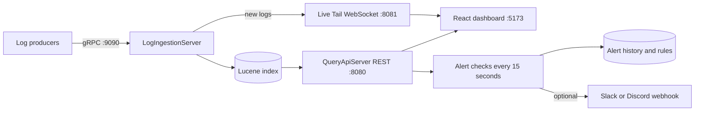

# LogStream — Distributed Log Analytics & Alerting Platform

LogStream is a Java and React prototype for collecting, indexing, searching, and monitoring application logs. It was developed for the Axlero Solutions internship project **Observability & Big Data**.

> **Project status:** This repository demonstrates the core workflow on a local development setup. The high-throughput and millisecond-latency goals in the project brief have not been benchmarked, and several brief features are not implemented yet. See [Current scope](#current-scope-and-project-brief) for details.

## What it does

- Accepts log entries over gRPC using Protocol Buffers.
- Indexes log service, level, message, and timestamp fields with Apache Lucene.
- Provides a REST API for search, aggregations, timeline data, and alerts.
- Displays log data in a React dashboard built with Vite.
- Pushes newly received logs to connected dashboard clients over WebSocket.
- Supports threshold rules by service and level, with optional Slack or Discord webhooks.

## How it works



Search and analytics read indexed data through the REST API. Live Tail receives newly ingested logs through a separate WebSocket connection; it only shows logs received while connected and does not backfill older indexed logs.

## Technology

| Area | Technology |
|---|---|
| Backend | Java 17+, gRPC, Protocol Buffers |
| Search and indexing | Apache Lucene 9.10 |
| REST API | Java built-in `HttpServer` |
| Live Tail | Java-WebSocket |
| Dashboard | React 18, Vite |
| Build tools | Maven and npm |

## Repository layout

```text
axlero-logstream-project/
├── log-ingestion-service/       Java backend and Protocol Buffers schema
├── logstream-dashboard/         React dashboard
├── postman/                     Postman collection for core REST requests
└── README.md
```

Key backend classes are in `log-ingestion-service/src/main/java/com/axlero/logstream/`:

- `LogIngestionServer.java` — starts gRPC ingestion and the Live Tail WebSocket server.
- `LuceneIndexer.java` — indexes logs and handles search and aggregations.
- `QueryApiServer.java` — starts the REST API and background alert checks.
- `AlertRuleStore.java`, `AlertHistory.java`, and `RuleAlertHistory.java` — store rules and alert history.
- `WebhookNotifier.java` — sends optional Slack or Discord notifications.

## Run locally

### Prerequisites

- Java 17 or later
- Maven 3.6+ or an IDE with Maven support
- Node.js and npm

### 1. Start log ingestion

Open `log-ingestion-service` as a Maven project in your IDE and run `LogIngestionServer.java`. It starts:

- gRPC on port `9090`
- Live Tail WebSocket on port `8081`

Keep it running.

### 2. Send sample logs

Run `BulkTestClient.java`. It sends 15 sample log entries across six services and three levels, then exits. Run it again whenever you want to add more sample logs.

### 3. Start the REST API

Run `QueryApiServer.java` and keep it running. It listens on port `8080` by default. Set the `PORT` environment variable to use a different port.

To enable webhook notifications, set `ALERT_WEBHOOK_URL` in the environment for `QueryApiServer` to a Slack or Discord incoming-webhook URL. If it is unset, alert evaluation and history still work, but no external notification is sent.

Check the API by opening [`http://localhost:8080/api/aggregations`](http://localhost:8080/api/aggregations). After sending sample logs, the response should contain log counts.

### 4. Start the dashboard

From the repository root, run:

```bash
cd logstream-dashboard
npm install
npm run dev
```

Open the local URL printed by Vite, usually `http://localhost:5173`.

## Search examples

Enter these in the dashboard’s Logs search:

```text
level:ERROR
service:payment-service
message:timeout
level:ERROR AND service:payment-service
service:billing-api AND response_time > 1000
```

The search endpoint returns up to 50 matching logs per request. `response_time` is an optional numeric field measured in milliseconds. Filter it with `>`, `>=`, `<`, `<=`, or `=`, alone or alongside other filters using `AND`. Only one `response_time` comparison is supported per query.

## REST API

The REST API uses `http://localhost:8080` by default.

| Method | Path | Description |
|---|---|---|
| `GET` | `/api/aggregations` | Total logs and counts by service and level |
| `GET` | `/api/search?q=<query>` | Search logs; returns at most 50 results |
| `GET` | `/api/timeline` | Counts grouped by minute |
| `GET` | `/api/alerts` | Current built-in alert status |
| `GET` | `/api/alerts/history` | Built-in alert history |
| `GET` | `/api/alert-rules` | List configured alert rules |
| `POST` | `/api/alert-rules` | Add a rule |
| `DELETE` | `/api/alert-rules?id=<id>` | Delete a rule |
| `GET` | `/api/alert-rules/history` | User-defined rule alert history |
| `WS` | `ws://localhost:8081` | Stream newly ingested logs to connected clients |

Example request body for `POST /api/alert-rules`:

```json
{
  "service": "*",
  "level": "ERROR",
  "threshold": 5,
  "windowMinutes": 5
}
```

The `service` and `level` fields default to `*` (any service) and `ERROR` if omitted. A rule becomes active when the number of matching logs is **greater than** its threshold within the selected window. The background checks run every 15 seconds. A Slack or Discord webhook is sent only when a rule transitions from inactive to active and `ALERT_WEBHOOK_URL` is configured.

The Postman collection at `postman/LogStream.postman_collection.json` includes five core GET requests. It does not currently include the alert-rule endpoints.

## Current scope and project brief

The project brief describes a larger target system. This repository currently implements a smaller prototype:

| Brief item | Current implementation |
|---|---|
| Ingest millions of log lines per minute and return search results in milliseconds | Performance has not been benchmarked; no throughput or latency claim is made here. |
| Search on `response_time`, for example `response_time > 1000` | Supported as an optional numeric field in milliseconds; combine with other filters using `AND`. |
| Run user-defined query rules every minute | Rules filter by service and level and count matches in a time window. Checks run every 15 seconds; arbitrary query expressions are not supported. |
| Send webhooks or emails | Optional Slack/Discord webhooks are implemented. Email notifications are not. |
| React dashboard with ECharts | The UI uses React and Vite. The project does not include ECharts; charts are implemented in the dashboard code. |

## Team

| Name | Role |
|---|---|
| Vimala (Team Lead) | Backend, dashboard, and testing |
| Doni Navaneeth Reddy | Backend |
| Shoyab Ahamad R | Frontend |
| Samata Pradip Chougule | Testing |

## Possible next steps

- Add response-time comparisons to saved alert-rule expressions.
- Support saved alert query expressions and align the evaluation interval with the project brief.
- Add email notifications and evaluate an ECharts-based dashboard if those remain project requirements.
- Benchmark ingestion throughput and search latency before making scale claims.
- Configure durable storage and access control for a multi-user deployment.